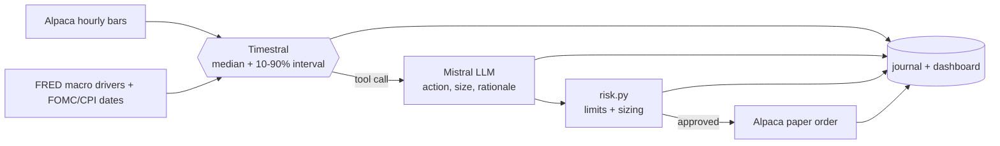

# Timestral Trading Agent

An autonomous agent that trades 8 ETFs (`SPY, QQQ, XLE, XLF, XLU, TLT, GLD, EEM`) on an **Alpaca paper account**.
A **Mistral LLM** calls **Timestral** as a tool to forecast prices, then proposes `buy / sell / hold` and a size.
**The LLM proposes, the code decides**: risk rules and dollar amounts are plain code. Paper trading only, not
investment advice.

Live dashboard: <https://capucine-masson.github.io/paper-trading/>

## Launch

See **[GETTING_STARTED.md](GETTING_STARTED.md)**.

## How it works

Every hour of the US session: Timestral forecasts the next 6 hours of each ETF (using the ETF's own prices plus
Brent, 10y and 2y yields, dollar index, VIX, high-yield spread and scheduled FOMC/CPI dates). The LLM reads the
forecasts and the portfolio and gives each symbol an action, a size and a short rationale. `risk.py` converts the
size to dollars and applies the limits. Approved orders go to Alpaca; everything is journaled and shown on the
dashboard.

## How do we know the decisions are sound?

We do not claim a profit: the forecast has **no measurable edge** at this horizon (below). We claim the agent
decides on honest inputs, uses the uncertainty, stays inside hard limits and explains itself.

| Question | Answer |
| --- | --- |
| Look-ahead? | Only completed bars are used; a daily macro value is visible from the next day 00:00 UTC; the backtest is walk-forward. Tests: `test_data`, `test_macro`, `test_backtest`. |
| Uncertainty? | The wider the forecast interval, the smaller the buy; no buy above 8% width or against the forecast. |
| Risk? | Hard limits in code: 25% max per position, 90% max exposure, 10% max daily loss, $5,000 capital floor, emergency stop (`enabled = false`). Paper URL is a constant; no order without `--execute`. |
| Explanations? | Each decision stores its rationale, forecast, risk verdict and order, visible in the dashboard. |

**Backtest** (`uv run python -m agent.backtest`, 180 days of hourly bars, walk-forward, details in `reports/backtest.md`):

| Forecast quality | Result |
| --- | --- |
| Error vs "price stays" forecast | 0.998 (no gain) |
| Right direction | 51.0% |
| 10-90% interval coverage | 79.4% (target 80%): the uncertainty is reliable |

| Last 28 days, same rules for all, 5 bps cost per order | Return | Max drawdown |
| --- | --- | --- |
| Cash | +0.00% | 0.00% |
| Equal-weight buy and hold | -1.13% | 3.18% |
| Momentum rule | -4.29% | 4.50% |
| Timestral-only rule (no LLM) | -0.78% | 4.26% |
| **Timestral + LLM (the agent)** | **-0.23%** | 4.85% |

These differences are noise over 28 days, not skill.

## Limits

- **LLM knowledge:** it sees tickers and its training data may overlap the backtest, so the backtest is not proof
  of skill. Live paper decisions are out-of-sample.
- **Short evidence:** 28 decision days, one market regime.
- **Transaction costs** are simulated in the backtest only: `cost_bps = 5` per order (spread and slippage, an assumption), applied to every strategy. Live paper fills have no such cost, so the dashboard PnL is gross.
- **Data:** free IEX feed; the dollar driver is the Fed broad index `DTWEXBGS` (free substitute for DXY).
- **Scheduling:** GitHub may delay or skip a run; market open/closed comes from the Alpaca clock.

## Code map

`agent/`: `data` and `macro` (inputs), `forecast` (Timestral), `llm` (prompts, tool call), `risk` (limits),
`broker` (Alpaca, the only module that talks to it), `cycle` and `store` (resumable steps, journal),
`backtest`, `export`. `web/`: static dashboard. `tests/`: `pytest`, no network.
