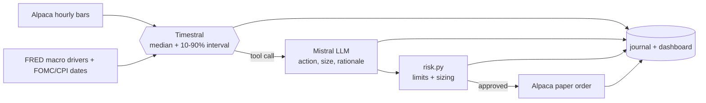

# Timestral Trading Agent

An autonomous agent that trades 8 ETFs (`SPY, QQQ, XLE, XLF, XLU, TLT, GLD, EEM`) on an **Alpaca paper account**.
A **Mistral LLM** calls **Timestral** as a tool to forecast prices, then proposes `buy / sell / hold` and a size.
**The LLM proposes, the code decides**: risk rules and dollar amounts are plain code. Paper trading only, not
investment advice.

Live dashboard: <https://capucine-masson.github.io/paper-trading/>

## Launch

See **[GETTING_STARTED.md](GETTING_STARTED.md)**.

## How it works

Every hour of the US session: Timestral forecasts the next 6 hours of each ETF (using the ETF's own prices plus
Brent, 10y and 2y yields, dollar index, VIX, high-yield spread and scheduled FOMC/CPI dates). The LLM reads the
forecasts and the portfolio and gives each symbol an action, a size and a short rationale. `risk.py` converts the
size to dollars and applies the limits. Approved orders go to Alpaca; everything is journaled and shown on the
dashboard.

## How do we know the decisions are sound?

We do not claim a profit: the forecast has **no measurable edge** at this horizon (below). We claim the agent
decides on honest inputs, uses the uncertainty, stays inside hard limits and explains itself.

| Question | Answer |
| --- | --- |
| Look-ahead? | Only completed bars are used; a daily macro value is visible from the next day 00:00 UTC; the backtest is walk-forward. Tests: `test_data`, `test_macro`, `test_backtest`. |
| Uncertainty? | The wider the forecast interval, the smaller the buy; no buy above 8% width or against the forecast. |
| Risk? | Hard limits in code: 30% max per position, 80% max exposure, 10% max daily loss, $8,000 capital floor, 1% minimum order ($100), emergency stop (`enabled = false`). Paper URL is a constant; no order without `--execute`. |
| Explanations? | Each decision stores its rationale, a one-sentence macro context written by the LLM from the readings it is shown (no causes beyond them), the forecast, the risk verdict and the order, visible in the dashboard. |

**Backtest** (`uv run python -m agent.backtest`, walk-forward from 2026-10-16, the day after Timestral's release on 2026-10-15; details in `reports/backtest.md`):

| Forecast quality | Result |
| --- | --- |
| Error vs "price stays" forecast | 0.992 (no real gain) |
| Right direction | 53.0% (50% is chance) |
| 10-90% interval coverage | 74.0% (target 80%): the intervals are somewhat too narrow, and calibrated would not mean profitable |

| From 2026-10-16, same rules for all, 5 bps cost per order | Return | Max drawdown | Average exposure |
| --- | --- | --- | --- |
| Cash | +0.00% | 0.00% | 0.0% |
| Equal-weight buy and hold (full exposure cap) | -1.97% | 2.82% | 78.7% |
| Buy and hold (same exposure as agent) | -1.75% | 2.50% | 69.7% |
| Momentum rule | -6.05% | 6.19% | 66.9% |
| Timestral-only rule (no LLM) | -0.55% | 4.13% | 70.3% |
| **Timestral + LLM (the agent)** | **-1.22%** | 3.95% | 70.8% |

At the same exposure, the agent (-1.22%) is 0.5 point above buy and hold (-1.75%), but below cash and the Timestral-only rule, and these few weeks are noise, not skill. The dashboard's
live "Buy & hold" line holds the same average exposure as the agent, so it is not flattered by cash.

## Limits

- **LLM and Timestral knowledge:** Mistral Small 4 (`mistral-small-2603`) was released on 2026-03-15 and Timestral on
  2026-10-15 (Mistral model cards). The backtest starts on 2026-10-16, after both, so neither model can have seen it.
  Timestral's training data is not published, which is why nothing before its release is evaluated.
- **Short evidence:** about 4 weeks of decisions, one market regime.
- **No news covariates:** the optional news bonus (GDELT) is not done. Timestral already gets FRED drivers as past
  covariates and scheduled FOMC/CPI dates as known-future covariates; news has no known future value.
- **Transaction costs** are simulated in the backtest only: `cost_bps = 5` per order (spread and slippage, an assumption), applied to every strategy. Live paper fills have no such cost, so the dashboard PnL is gross and "Est. costs" applies the same 5 bps to the filled amounts.
- **Data:** free IEX feed; the dollar driver is the Fed broad index `DTWEXBGS` (free substitute for DXY).
- **Scheduling:** GitHub may delay or skip a scheduled run, so an external cron calls the workflow every hour
  (setup in [GETTING_STARTED.md](GETTING_STARTED.md#deploy-optional)); the GitHub `schedule` stays as a fallback and
  a duplicate run places no second order. Its token expires and must be renewed. Market open/closed comes from
  the Alpaca clock.

## Code map

`agent/`: `data` and `macro` (inputs), `forecast` (Timestral), `llm` (prompts, tool call), `risk` (limits),
`broker` (Alpaca, the only module that talks to it), `cycle` and `store` (resumable steps, journal),
`backtest`, `export`. `web/`: static dashboard. `tests/`: `pytest`, no network.
