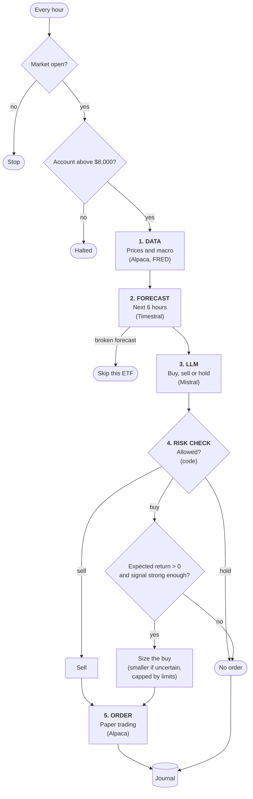

# Timestral Trading Agent

An autonomous agent that trades 8 ETFs (`SPY, QQQ, XLE, XLF, XLU, TLT, GLD, EEM`) on an **Alpaca paper account**.
A **Mistral LLM** calls **Timestral** as a tool to forecast prices, then proposes `buy / sell / hold` and a size.
**The LLM proposes, the code decides**: risk rules and dollar amounts are plain code. Paper trading only, not
investment advice.

Live dashboard: <https://capucine-masson.github.io/paper-trading/>

## Three things to know

1. **Honest calibration:** the forecast has no measurable edge at this horizon, and we say so. Its 10-90% interval
   covers 72.5% of outcomes instead of 80%, so it is somewhat too narrow ([backtest](#how-do-we-know-the-decisions-are-sound)).
2. **Uncertainty drives the size:** a wider forecast interval means a smaller buy, and a weak signal means no buy.
3. **Guardrails live in code:** the LLM proposes an action and a share of the maximum position, never an amount or a
   price. The code can veto it and enforces hard limits that nothing can bypass.

## Launch

See **[GETTING_STARTED.md](GETTING_STARTED.md)**.

## Code map

| File | Role |
| --- | --- |
| `agent/data.py` | Hourly prices from Alpaca |
| `agent/macro.py` | Macro figures from FRED |
| `agent/forecast.py` | Timestral forecast |
| `agent/llm.py` | Prompts and Mistral call |
| `agent/risk.py` | Veto, sizing, limits (pure code) |
| `agent/broker.py` | Alpaca (the only file that talks to it) |
| `agent/cycle.py` | One cycle, in resumable steps |
| `agent/store.py` | SQLite journal |
| `agent/backtest.py` | Backtest report |
| `agent/export.py` | JSON for the dashboard |
| `web/` | Static dashboard |
| `tests/` | `pytest`, no network |

## Deep dive: how one decision is made

The numbered blocks match the numbered steps below.

**1. Data.** Hourly bars from Alpaca (free IEX feed), 400 bars of context. A bar is used only once completed; a gap stays `NaN`,
never filled; stale data (older than 2.5 h) is rejected. Six FRED drivers (Brent, 10y, 2y, dollar index, VIX, high-yield spread) are
past covariates, visible only from the next day 00:00 UTC. FOMC and CPI release dates are a known-future covariate (1 on the
hour of a release, else 0).

**2. Forecast.** Timestral 28M runs on CPU, loaded once, and forecasts the next 6 hours. Over 1 hour an ETF's move is almost pure
noise, so there is a little more signal over 6 (the horizon was not tuned). A forecast with non-finite values or crossing
quantiles is rejected. The code then computes:

- **expected return**: median over last price;
- **uncertainty**: interval width over median;
- **signal strength** (0 to 1): expected return over interval width, divided by a strong past signal (`signal_strong`), capped at 1.

**3. LLM.** One conversation for all symbols. The LLM decides which forecasts to request, reads them with the portfolio, and
returns a structured answer per symbol (validated, 1 retry, then rejected): `buy / sell / hold`, a share of the maximum position and a
short rationale. It never outputs an amount or a price. It does not see the macro drivers, because Timestral already used them.

**4. Risk (`risk.py`, pure code).** Verdicts are computed strongest signal first, and each approved order is applied to the portfolio
before the next, so exposure limits hold inside a cycle. Limits: 30% max per position, 80% max exposure, 10% max daily loss,
5 orders per cycle, 1% minimum order, emergency stop.

**5. Execution.** Alpaca paper only (the URL is a constant), and no order without `--execute`. Each step (data, forecast, LLM, verdict,
order) is journaled once per `(cycle, symbol, step)`, so a re-run reads it back instead of redoing it. The LLM output is recorded,
not recomputed. The `client_order_id` is deterministic, so a re-run or a duplicate trigger never places a second order. A failing
symbol does not stop the others.

### Why these choices

| Choice | Why |
| --- | --- |
| The LLM proposes a share, the code computes dollars | LLMs are unreliable at arithmetic and can be wrong with confidence; sizes and limits must be exact and testable. |
| Signal strength from the code, not LLM confidence | An LLM's stated confidence is not calibrated; a number computed from the forecast is reproducible. |
| Wide interval, small buy | Timestral's interval is the only uncertainty we have; using it to size is the most direct way to act on it. |
| Long only, no short | Fewer ways to lose more than invested; simpler to explain to a client. |
| 6-hour horizon, hourly cycle | Less noise than 1 hour, and the forecast stays fresh. |
| Timestral-28M, not the 209M | Cheap and fast (111 MB, 0.18 s per forecast). The 209M is 8x slower for no real gain (below). |
| Mistral Small 4 | Cheap and fast for a structured task; the decision is constrained by the code anyway. |
| Static dashboard, SQLite journal committed by the workflow | No server to run or secure; the journal survives the ephemeral CI machine. |

Timestral-28M against the biggest model (209M, 837 MB) on the same 436 forecasts. The 5M and 123M were not tested.

| Model | Error vs "price stays" | Right direction | 10-90% coverage | Seconds per forecast |
| --- | --- | --- | --- | --- |
| **28M (used)** | 0.999 | 51.2% | 72.5% | 0.18 |
| 209M | 1.010 | 50.2% | 76.8% | 1.51 |

## How do we know the decisions are sound?

We do not claim a profit: the forecast has **no measurable edge** at this horizon (below). We claim the agent
decides on honest inputs, uses the uncertainty, stays inside hard limits and explains itself.

| Question | Answer |
| --- | --- |
| Look-ahead? | Only completed bars are used; a daily macro value is visible from the next day 00:00 UTC; the backtest is walk-forward. Tests: `test_data`, `test_macro`, `test_backtest`. |
| Who decides? | The LLM calls Timestral as a tool, then picks `buy / sell / hold`, a size and writes the rationale. The code never decides for it: it computes the numbers and can veto a decision (below). |
| Uncertainty? | Sized by the interval width, gated by the signal strength (steps 2 and 4 above). Signal strength measures how strong the forecast is, not a probability, and is not asked of the LLM, whose own confidence is not reliable. |
| Risk? | Hard limits in code (step 4 above), a $8,000 capital floor and an emergency stop (`enabled = false`). Paper URL is a constant; no order without `--execute`. |
| Explanations? | Each decision stores its rationale, the forecast, the market data given to Timestral and whether a FOMC/CPI release falls in the forecast window (recorded by the code, not written by the LLM, and not shown to the LLM), the risk verdict and the order, visible in the dashboard. |

**Backtest** (`uv run python -m agent.backtest`, walk-forward from 2026-10-16, the day after Timestral's release on 2026-10-15; details in `reports/backtest.md`):

| Forecast quality | Result |
| --- | --- |
| Error vs "price stays" forecast | 0.999 (no real gain) |
| Right direction | 51.2% (50% is chance) |
| 10-90% interval coverage | 72.5% (target 80%): the intervals are somewhat too narrow, and calibrated would not mean profitable |

| From 2026-10-16, same rules for all, 5 bps cost per order | Return | Max drawdown | Average exposure |
| --- | --- | --- | --- |
| Equal-weight buy and hold (full exposure cap) | -2.44% | 2.82% | 78.3% |
| Buy and hold (same exposure as agent) | -1.94% | 2.24% | 62.3% |
| Timestral-only rule (no LLM) | -2.90% | 4.90% | 66.6% |
| **Timestral + LLM (the agent)** | **-1.79%** | 3.52% | 63.6% |

At the same exposure, the agent (-1.79%) does the same as buy and hold (-1.94%) and the Timestral-only rule (-2.90%): no measurable edge, and these few weeks are noise, not skill. The dashboard's
live "Buy & hold" line holds the same average exposure as the agent, so it is not flattered by cash.

## Limits

- **LLM and Timestral knowledge:** Mistral Small 4 (`mistral-small-2603`) was released on 2026-03-15 and Timestral on
  2026-10-15 (Mistral model cards). The backtest starts on 2026-10-16, after both, so neither model can have seen it.
  Timestral's training data is not published, which is why nothing before its release is evaluated.
- **Short evidence:** about 4 weeks of decisions, one market regime.
- **Context length:** 400 hourly bars. We compared 200, 400 and 800 on the same 470 forecasts: 400 was the best on error and direction and faster than 800, but the gaps are within the noise. It is a reasonable choice, not a proven optimum.
- **No news covariates:** news (GDELT) is not used. Timestral already gets FRED drivers as past
  covariates and scheduled FOMC/CPI dates as known-future covariates; news has no known future value.
- **Transaction costs** are simulated in the backtest only: `cost_bps = 5` per order (spread and slippage, an assumption), applied to every strategy. Live paper fills have no such cost, so the dashboard PnL is gross and "Est. costs" applies the same 5 bps to the filled amounts.
- **Data:** free IEX feed; the dollar driver is the Fed broad index `DTWEXBGS` (free substitute for DXY).
- **Scheduling:** GitHub may delay or skip a scheduled run, so an external cron calls the workflow every hour
  (setup in [GETTING_STARTED.md](GETTING_STARTED.md#deploy-optional)); the GitHub `schedule` stays as a fallback and
  a duplicate run places no second order. Its token expires and must be renewed. Market open/closed comes from
  the Alpaca clock.
